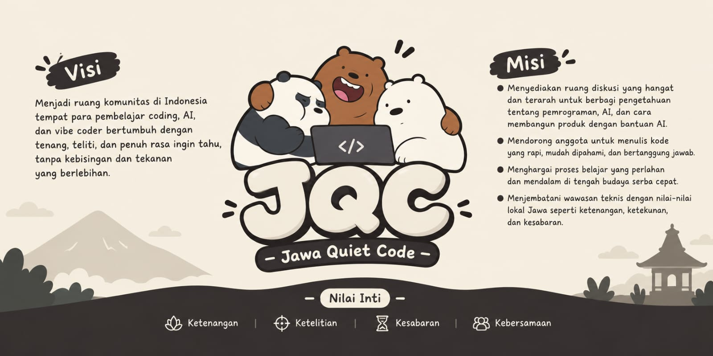

   
  
   
   

  
  
  

  <h1>Jawa Quiet Code</h1>
  
<strong>Learn quietly. Code thoughtfully. Grow together.</strong>

  
A calm corner for curious people learning, building, and exploring with code and AI.

 

<table>
  <tr>
    <td width="50%" valign="top" bgcolor="#20212B">
      <h3>About JQC</h3>
      
Jawa Quiet Code is an Indonesian community for coding learners, AI enthusiasts, and builders who value steady progress over unnecessary noise.

      
We make space for thoughtful conversations, practical experiments, and meaningful work.

    </td>
    <td width="50%" valign="top" bgcolor="#292A36">
      <h3>Our Direction</h3>
      
To help people understand technology, not merely follow it—while building with clarity, responsibility, and care.

      
<em>More learning. Less noise.</em>

    </td>
  </tr>
</table>

## The JQC Approach

<table>
  <tr>
    <td align="center" width="25%" bgcolor="#2B2D42">
      <h3>01</h3>
      <strong>Calmness</strong> 
      Room to think and learn well.
    </td>
    <td align="center" width="25%" bgcolor="#363849">
      <h3>02</h3>
      <strong>Precision</strong> 
      Clarity in code, ideas, and craft.
    </td>
    <td align="center" width="25%" bgcolor="#45465A">
      <h3>03</h3>
      <strong>Patience</strong> 
      Strong foundations take time.
    </td>
    <td align="center" width="25%" bgcolor="#5A5059">
      <h3>04</h3>
      <strong>Community</strong> 
      We grow through shared progress.
    </td>
  </tr>
</table>

## What We Explore

<table>
  <tr>
    <td width="50%" valign="top">
      <h4>Software &amp; Craft</h4>
      <ul>
        <li>Programming fundamentals</li>
        <li>Clean code and documentation</li>
        <li>Debugging and problem solving</li>
      </ul>
    </td>
    <td width="50%" valign="top">
      <h4>AI &amp; Building</h4>
      <ul>
        <li>Responsible AI-assisted workflows</li>
        <li>Vibe coding and experimentation</li>
        <li>Product development</li>
      </ul>
    </td>
  </tr>
</table>

## Community Principles

> **Understand before you optimize.**
> **Build responsibly.**
> **Ask freely. Share generously.**
> **Progress does not have to be loud to be meaningful.**

We believe a good community is accessible, respectful, and purposeful. Questions are welcome, learning matters more than performance, and technology should be used with care.

## Join the Journey

Whether you are taking your first steps or already building products, there is room for you here. Learn at your own pace, share what you discover, and help make the path clearer for someone else.

   
  

  <strong>Jawa Quiet Code</strong> · A quieter way to learn, build, and grow.
   
   

